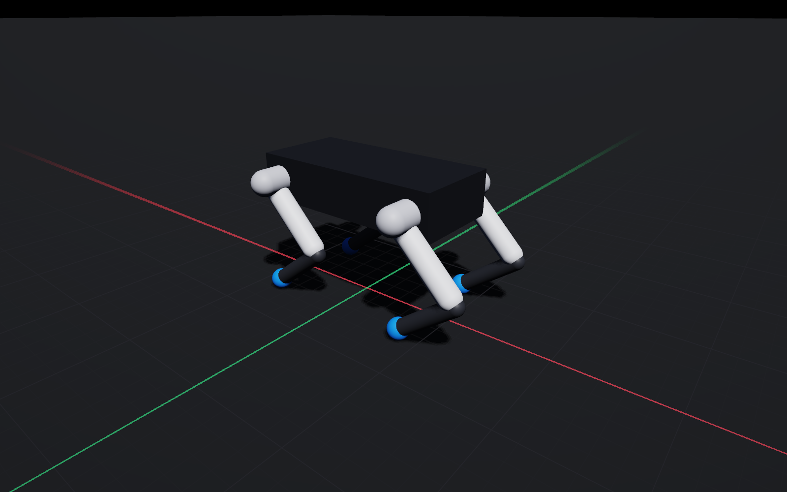
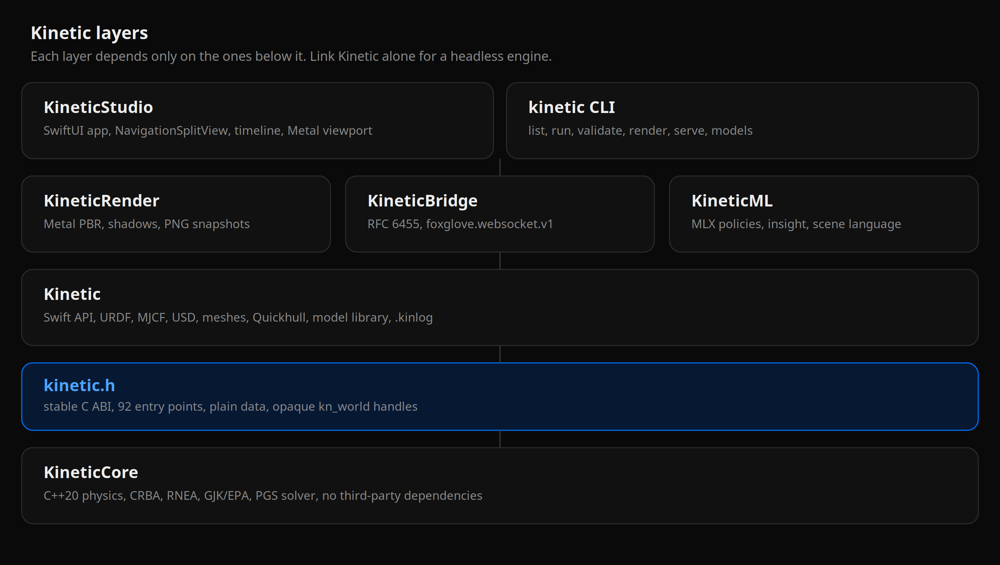
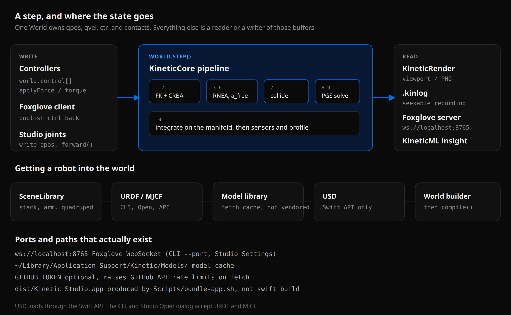
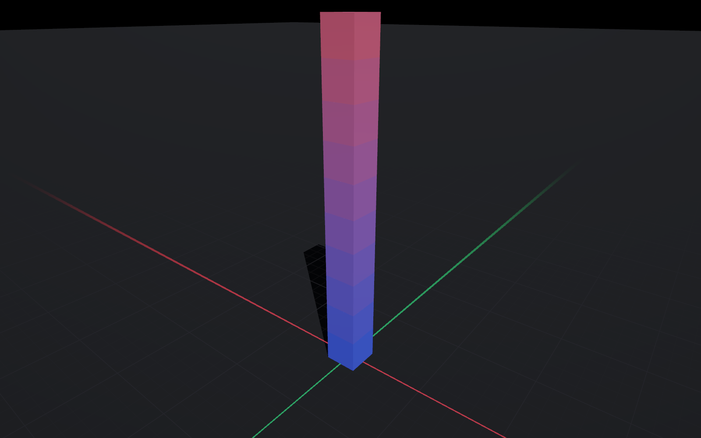

<div align="center">

# Kinetic

**Native macOS robotics simulation.**
Rigid-body physics, a Metal renderer, and Foxglove-compatible telemetry in one repository, with no runtime to install.

[Documentation](https://shubhxho.github.io/kinetic) ·
[Getting started](https://shubhxho.github.io/kinetic/getting-started/install.html) ·
[Physics](https://shubhxho.github.io/kinetic/physics/dynamics.html) ·
[Benchmarks](https://shubhxho.github.io/kinetic/reference/benchmarks.html)

</div>

<p align="center">
  
</p>

```bash
git clone https://github.com/shubhxho/kinetic
cd kinetic
swift build -c release
./.build/release/kinetic validate
./.build/release/kinetic run stack --duration 1
```

No Python. No ROS. No container. No CUDA. One build command, on a Mac.
`validate` and `run` do not need Metal. Studio and `kinetic render` do.

## What is in here

<p align="center">
  
</p>

| Layer | What it is |
| --- | --- |
| **KineticCore** | C++20 rigid-body physics: reduced-coordinate articulated dynamics, convex collision, soft-constraint solver. No dependencies. |
| **kinetic.h** | A stable C ABI, 92 entry points. Bindable from anything with a C FFI. |
| **Kinetic** | Swift API, URDF and MJCF importers, USD geometry, mesh loading, Quickhull, `.kinlog` recording, model library. |
| **KineticRender** | Metal forward PBR renderer: instanced geometry, shadow mapping, contact overlays, headless PNG snapshots. |
| **KineticBridge** | A hand-written RFC 6455 server speaking the Foxglove WebSocket protocol. |
| **KineticML** | On-device machine learning through MLX: learned control, streaming anomaly detection, natural-language scene commands. |
| **KineticStudio** | SwiftUI app: `NavigationSplitView` shell, dockable panel workspace, timeline scrubbing over full simulation state, live plots, joint posing, command palette. |
| **kinetic CLI** | `list`, `info`, `run`, `bench`, `validate`, `render`, `replay`, `serve`, `models`. |

<p align="center">
  
</p>

## Physics

- **Reduced coordinates.** Joints are exact by construction and cannot drift, no matter the timestep or gear ratio. CRBA for the joint-space inertia, RNEA for bias forces, LDLᵀ with implicit damping folded in.
- **Speculative contacts.** A separated point may approach by at most its remaining gap this step. Resting bodies sit at exactly their radius, with zero steady-state penetration, and a 120 m/s projectile stops dead at a 10 mm wall.
- **True friction cone.** Second-order cone projection, not a pyramid, so grip is isotropic and sliding objects do not curve.
- **Physically parameterised contact.** A time constant and a damping ratio, derived against each constraint's own effective inertia, so a 1 g screw and a 1 t chassis settle identically from the same setting.
- **Bit-identical determinism**, including with the threaded narrowphase enabled. Asserted on every run of `kinetic validate`.

## Validated, not asserted

```text
$ kinetic validate

  PASS  free fall                         error 0.00 nm
  PASS  resting contact                   penetration 0.000 mm
  PASS  pendulum energy drift             0.210 % over 10 s
  PASS  angular momentum (RK4)            drift 0.0008 %
  PASS  Coulomb friction                  held 0.00 mm, slid 1.623 m
  PASS  box stack stability               max drift 7.31 mm
  PASS  no tunnelling at 120 m/s          stopped at x = -0.1114 m
  PASS  threaded narrowphase determinism  420 coordinates compared
  PASS  determinism                       168 coordinates compared

  all checks passed
```

Every check is a closed-form or conservation-law comparison. Plus 53 unit tests
across ten suites. [What each one proves.](https://shubhxho.github.io/kinetic/physics/accuracy.html)

The transcript above is the engine's documented output, recorded from a macOS
release build. This checkout was reviewed on Linux, where the Swift/Metal
toolchain is not present, so that command was not re-run here.

## Performance

Apple M4, single-threaded except where noted, double precision. Numbers come
from `kinetic bench` on that machine; they are not re-measured in this
checkout. The portable core was timed here with
`./Scripts/bench-core.sh --check --seconds 1` (41 checks passed). Those Linux
ms/step figures live in the [benchmarks chapter](https://shubhxho.github.io/kinetic/reference/benchmarks.html);
they are not a substitute for the M4 table.

| Scene | nv | ms/step | realtime |
| --- | --- | --- | --- |
| cartpole | 2 | 0.0005 | 4124× |
| 6-DOF arm | 6 | 0.0015 | 1362× |
| 20-link chain | 20 | 0.0040 | 497× |
| quadruped | 18 | 0.0141 | 142× |
| 10-box stack | 60 | 0.0868 | 23× |
| mixed primitives | 144 | 0.2380 | 8.4× |
| 60 dominoes | 360 | 0.3948 | 5.1× |

## Thirty seconds of it

```swift
import Kinetic

let world = World()
world.addGround(friction: 1.0)

for i in 0..<10 {
    world.addRigidBody(name: "box\(i)",
                       shape: .box(halfExtents: Vec3(0.1, 0.1, 0.1)),
                       density: 500,
                       pose: Pose(position: Vec3(0, 0, 0.1 + 0.2005 * Double(i))))
}
world.compile()
world.step(3000)

print(world.contacts().count)   // 40 contact points holding the tower up
```

<p align="center">
  
</p>

```bash
kinetic info panda.urdf                       # inspect a model
kinetic run quadruped --duration 10 --record walk.kinlog
kinetic bench                                 # benchmark every scene
kinetic render stack --steps 400 --out stack.png
kinetic serve arm --port 8765                 # stream to Foxglove
kinetic models list
kinetic models fetch unitree-go2
kinetic models validate unitree-go2
```

The PNG figures in `docs/src/images/` are headless captures from
`kinetic render` on macOS (1600×1000). They are the same Metal renderer Studio
uses. This environment cannot re-render them.

## Kinetic Studio

```bash
./Scripts/bundle-app.sh release
open "dist/Kinetic Studio.app"
```

`swift build` emits a bare executable. The script wraps it as
`dist/Kinetic Studio.app` (Info.plist, icon, embedded `kinetic` CLI, ad-hoc
signature). Running `.build/release/KineticStudio` directly gives no Dock icon
or menu bar.

- **Dockable panel workspace** inside a `NavigationSplitView` shell, with a
  scene-tree sidebar, an inspector, and a binary-split layout tree in the
  detail column. Four presets (Simulate, Analyse, Debug, Foxglove). Twelve
  panel kinds: 3D viewport, plots, raw messages, table, state transitions,
  diagnostics, log, joints, actuators, scene tree, inspector, ML insights.
- **Liquid Glass** chrome on macOS 26 (`GlassEffectContainer`, `.glassEffect`,
  `.buttonStyle(.glass)`), with a deliberate `.ultraThinMaterial` fallback below.
- **Timeline scrubbing over full simulation state.** Twenty seconds of every
  `qpos`, `qvel` and contact set, restored directly. Not a replay of messages:
  the actual state, resumable.
- **Command palette** (`⌘K`) for every action.
- **Joint posing:** drag a slider, watch the link move, verify an imported
  URDF's axes.
- **Solver parameters editable while running.**
- **Settings** (`⌘,`): timeline history length, viewport frame rate, telemetry
  port and publish rate.

Studio Open (`⌘O`) accepts URDF and MJCF. USD is a Swift API, not that dialog.

## On-device ML

Through [MLX](https://github.com/ml-explore/mlx-swift), on the same GPU the
viewport uses. No Python, no separate process.

- **Learned control:** a cart-pole policy trained in-repo by cross-entropy
  method, measured against an analytic LQR baseline derived from the scene's
  real inertias.
- **Telemetry insight:** seven streaming statistical detectors plus an optional
  learned joint-pattern mode, at ~1 µs per step for nine channels.
- **Scene language:** "drop five 10 cm boxes from 2 metres onto ice" parses
  deterministically, shows you the plan, and changes nothing until you approve.

Each degrades honestly when MLX is unavailable rather than failing. A
`swift build` CLI product has no MLX metallib (SwiftPM has no Metal compile
step); open the package in Xcode once, or let `Scripts/bundle-app.sh` stage a
metallib from DerivedData when one exists.

## Robot models

```bash
kinetic models list
kinetic models fetch unitree-go2
kinetic models validate unitree-go2
```

Fourteen published robots: Franka, UR, Unitree Go2/G1/H1, ANYmal, Shadow Hand,
Robotiq, and three NVIDIA IsaacGymEnvs URDFs. Every upstream URL was verified
before it was recorded, licences are surfaced, and nothing is re-hosted.

Fetch is sparse (subtree blobs, not a whole clone) and honours `GITHUB_TOKEN`
when set. The cache is `~/Library/Application Support/Kinetic/Models/`. Do not
put a real token in a file in this repo.

USD import via ModelIO brings in Omniverse and Isaac assets, with the Y-up to
Z-up conversion applied to transforms and vertices and a best-effort UsdPhysics
parser for ASCII layers. The boundary between what is read and what is inferred
is explicit: nothing invents a mass silently. USD is not a `kinetic run` input.

## Talks to Foxglove, both directions

Kinetic *is* the WebSocket server. Point any Foxglove client at
`ws://localhost:8765` and the scene appears in its 3D panel with a live transform
tree, contact arrows, and every numeric channel plottable. Clients can publish
control back.

It is also a **client**: the Foxglove switch in Studio can attach to a Kinetic
instance running on another machine, subscribe to its topics and drive its
actuators.

## Formats

| Reads | Writes |
| --- | --- |
| URDF, MJCF, USD/USDA/USDC/USDZ (API) | `.kinlog` (seekable, self-describing) |
| STL (binary + ASCII), OBJ, ASCII PLY | CSV channel export |
| | PNG (headless render) |

CLI and Studio Open load URDF and MJCF. USD, STL, OBJ and PLY go through the
Swift importers.

## What it is not

- **Not a GPU training farm.** One world, extremely well. If you need thousands
  of parallel environments, use Isaac.
- **Not photorealistic.** The viewport makes physics legible, not marketing
  footage.
- **Not cross-platform.** The physics core is portable C++; the renderer is Metal,
  the CLI links AppKit, and Studio is SwiftUI.
- **No soft bodies, cloth, fluids, tendons or camera sensors.**

[The full comparison, including where MuJoCo, Bullet, Gazebo and Foxglove win.](https://shubhxho.github.io/kinetic/reference/comparison.html)

## Requirements

| | What the package declares | What a current `swift build` needs |
| --- | --- | --- |
| OS | macOS 14+ | macOS 14+ to run |
| Toolchain | `swift-tools-version: 6.0` | Swift 6.3 / Xcode 26, because [mlx-swift 0.31.x](https://github.com/ml-explore/mlx-swift) declares `swift-tools-version: 6.3` |
| GPU | Metal 3 | Metal 3 for the viewport and `kinetic render` |

CI builds on `macos-26` for that reason. `swift --version` and
`xcodebuild -version` are the checks to run before building.

## Configuration

No config files, no cloud account, no paid services.

| Name | Where | Default |
| --- | --- | --- |
| `GITHUB_TOKEN` | environment | unset (anonymous GitHub API, 60 req/h) |
| Model cache | `~/Library/Application Support/Kinetic/Models/` | created on first fetch |
| Telemetry port | CLI `--port`, Studio Settings | `8765` |
| Publish rate | CLI `--rate`, Studio Settings | 30 Hz |
| Timeline window | Studio Settings | 20 s |
| `KINETIC_AUTOPLAY` | environment, Studio only | unset; if present, playback starts on launch (profiling) |

Do not commit tokens. A dummy `GITHUB_TOKEN=ghp_example_not_a_real_token` is
enough to describe the shape.

## Documentation

```bash
brew install mdbook   # or the v0.5.4 binary used by CI
mdbook serve docs --open
# same build GitHub Pages and Vercel run:
./Scripts/build-docs.sh
```

The book covers install, Studio, conventions, the algorithms with equations, a
cookbook, ML, the model library, file formats, the wire protocol, both API
surfaces, benchmarks, comparisons, troubleshooting and a glossary.

Two static hosts, same `docs/book` output:

| Host | When it publishes | URL |
| --- | --- | --- |
| GitHub Pages | push to `main` (`.github/workflows/docs.yml`) | https://shubhxho.github.io/kinetic |
| Vercel | import this repo, or a `VERCEL_TOKEN` on the Vercel workflow | project URL after the first deploy |

The simulator itself is a macOS app and is not deployed. `vercel.json` builds
only the book. Hobby is enough; this repo does not attach a paid Vercel plan.

## License

MIT.
