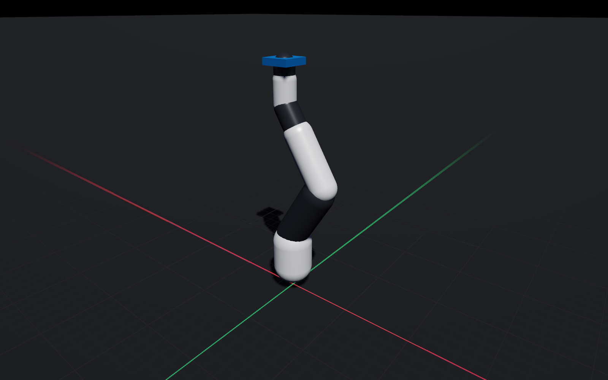
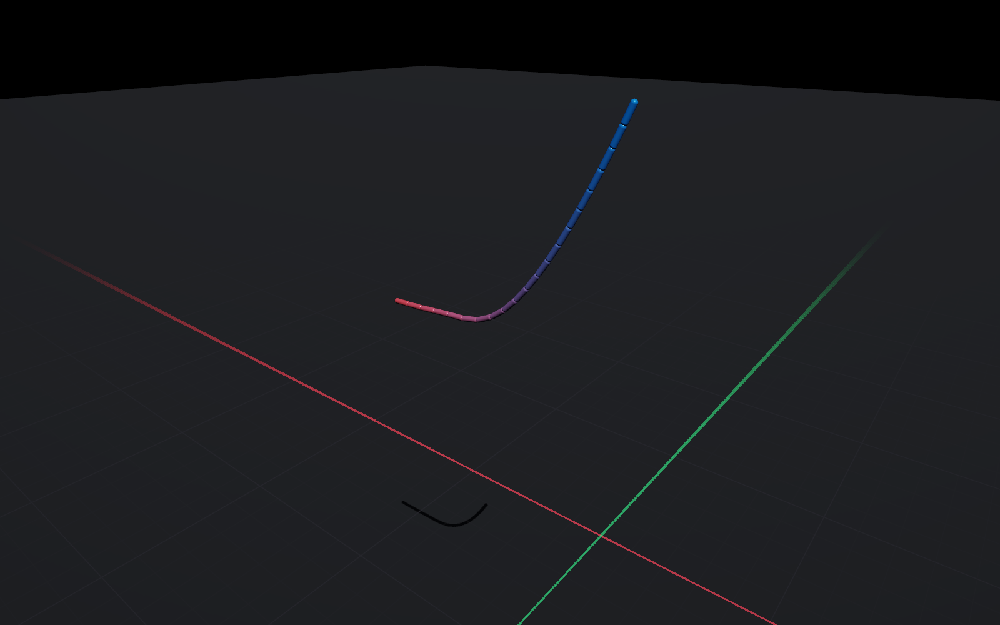
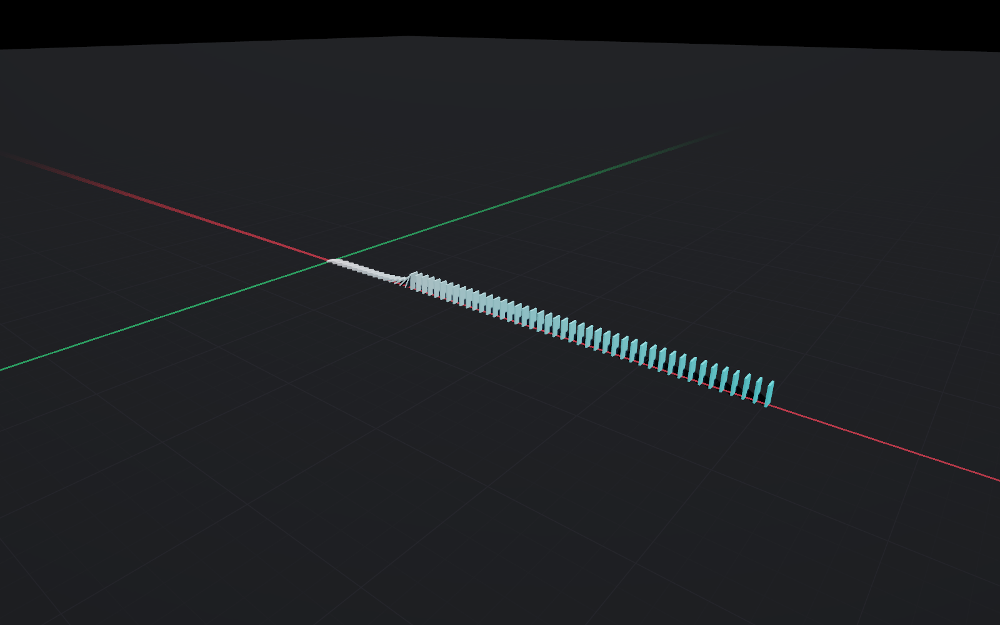
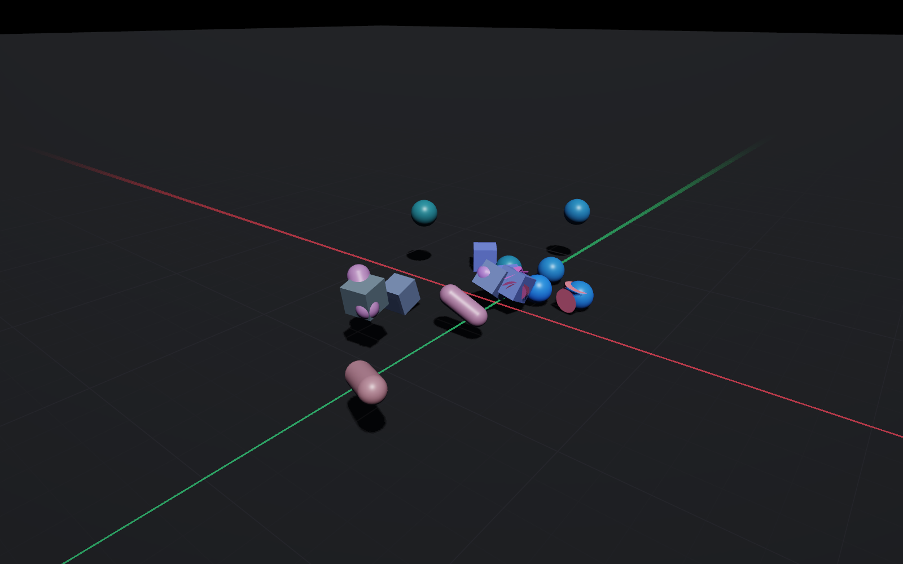

# The `kinetic` CLI

```text
kinetic <command> [arguments]

  list                       show the built-in scenes
  info     <scene|file>      print the model tree and mass properties
  run      <scene|file>      simulate, optionally recording or serving
  bench    [scene...]        measure step cost across scenes
  validate                   run the physics validation suite
  render   <scene|file>      render a frame to PNG, headless
  replay   <file.kinlog>     inspect or export a recording
  serve    <scene|file>      stream live telemetry over WebSocket
  models   [subcommand]      browse, fetch and validate published robots
```

Anywhere a scene is accepted you may give a built-in name (`kinetic list`), or a
path to a `.urdf` or MJCF `.xml`. Files without a recognised extension are
sniffed for a `<robot>` or `<mujoco>` root element. USD is not a CLI input;
use the Swift `USDImporter` API.

Built-in ids: `stack`, `arm`, `quadruped`, `cartpole`, `chain`, `dominoes`,
`mixed`. Six headless `kinetic render` captures from macOS (Metal, 1600x1000),
not Studio screenshots:

<div class="kn-compare">
  <div class="kn-figure">
    
    <p class="kn-caption"><code>kinetic render arm</code></p>
  </div>
  <div class="kn-figure">
    
    <p class="kn-caption"><code>kinetic render chain</code></p>
  </div>
</div>
<div class="kn-compare">
  <div class="kn-figure">
    
    <p class="kn-caption"><code>kinetic render dominoes</code></p>
  </div>
  <div class="kn-figure">
    
    <p class="kn-caption"><code>kinetic render mixed</code>: spheres, boxes, capsules, cylinders</p>
  </div>
</div>

`cartpole` has no committed figure. `quadruped` and `stack` are on the
[landing page](../introduction.md).

## `info`

```bash
kinetic info quadruped
```

```text
Model  quadruped

  articulations   2
  links           14
  geoms           18
  coordinates nq  20
  degrees of freedom nv  18
  actuators       12
  sensor channels 10
  total mass      16.703 kg
  timestep        2.000 ms

  world  1 link
      ground                        Fixed      m=0.000
  quadruped  13 links
      torso                         free       m=10.454
        fl_hip                      revolute   m=0.309  [-0.80, 0.80]
        fl_thigh                    revolute   m=0.900  [-2.20, 1.20]
        fl_shank                    revolute   m=0.500  [0.20, 2.70]
        ...
```

The fastest way to check that an import produced the topology you expected.

## `run`

```bash
kinetic run quadruped --duration 10 --record walk.kinlog
kinetic run panda.urdf --realtime --serve --port 8765
```

| Flag | Meaning |
| --- | --- |
| `--duration <s>` | simulated seconds (default 5) |
| `--steps <n>` | explicit step count, overrides `--duration` |
| `--realtime` | pace to wall-clock time instead of running flat out |
| `--record <path>` | write a `.kinlog` |
| `--serve` | also start the telemetry server |
| `--port <n>` | telemetry port (default 8765) |

A live status line reports simulated time, realtime factor, step cost, contact
count and total energy. When the run ends with `--serve`, the server stays up.

## `bench`

```bash
kinetic bench
kinetic bench --serial          # disable the threaded narrowphase, for comparison
kinetic bench dominoes --seconds 10
```

```text
scene            nv  geoms   steps   ms/step   steps/s  realtime  contacts
stack            60     11    1000    0.0868     11517     23.0x        40
arm               6      8    1000    0.0015    680728   1361.5x         0
quadruped        18     18    1000    0.0141     71083    142.2x         4
cartpole          2      3    1000    0.0005   2062096   4124.2x         0
chain            20     21    1000    0.0040    248573    497.1x         0
dominoes        360     61    1000    0.3948      2533      5.1x       282
mixed           144     25    1000    0.2380      4201      8.4x       100
```

Each scene is warmed up before timing so first-touch page faults do not land in
the measurement. `swift test` runs the same protocol as assertions in
`Tests/KineticTests/BenchmarkTests.swift`. On a machine without Swift, the
C++ core has the matching gate:

```bash
./Scripts/bench-core.sh --check --seconds 1
```

`--check` exits non-zero if a scene's nv/geoms drift, a contact-free scene
grows contacts, serial and threaded paths diverge, or an articulated scene
becomes more expensive per step than a contact-rich pile. Absolute ms/step is
printed, not asserted. See [Benchmarks](../reference/benchmarks.md).

## `validate`

Runs the physics validation suite and exits non-zero on failure, which makes it
usable as a CI gate. See [Accuracy and validation](../physics/accuracy.md).

## `render`

```bash
kinetic render stack --steps 400 --out stack.png --width 2400 --height 1500
kinetic render arm --light --out arm-light.png
```

`--no-contacts` hides the contact overlay. Default size is 1600×1000, which is
the size of the committed figures in `docs/src/images/`.

Fully headless — it opens no window and needs no display session, so it works
over SSH and in CI. Useful for regression images of a model's rest pose.

## `replay`

```bash
kinetic replay walk.kinlog
kinetic replay walk.kinlog --csv walk.csv
```

```text
Recording  quadruped

  engine        Kinetic 1.0.0
  frames        5000
  duration      10.000 s
  timestep      2.000 ms
  nq / nv       20 / 18
  geoms         18
  channels      61
```

`--csv` exports every channel — joint states, controls, sensors, step timings,
contact counts — as one wide table for analysis elsewhere.

## `serve`

```bash
kinetic serve arm --port 8765 --rate 60
```

Steps the scene in realtime on a background queue and publishes it. Any Foxglove
client can connect; so can Studio. See [Connecting Foxglove](../telemetry/foxglove.md).

## `models`

```bash
kinetic models list
kinetic models info unitree-go2
kinetic models fetch unitree-go2
kinetic models validate unitree-go2
kinetic models cache
kinetic models purge unitree-go2
```

| Subcommand | What it does |
| --- | --- |
| `list [query]` | registry rows: id, vendor, format, dof, actuators, licence, cached |
| `info <id>` | description, licence URLs, notes |
| `fetch <id>` | sparse download from the upstream GitHub repo into the local cache |
| `validate <id>` | import the cached description and print a `ModelValidation` report |
| `cache` | path, count, size |
| `purge [id]` | delete one id, or the whole cache |

Fourteen registry entries, none vendored. Fetch honours `GITHUB_TOKEN` when
set. The cache is `~/Library/Application Support/Kinetic/Models/`. Full
caveats (no `<equality>` / `<tendon>`, COLLADA rejected, and so on) are in
[The model library](../models.md).
