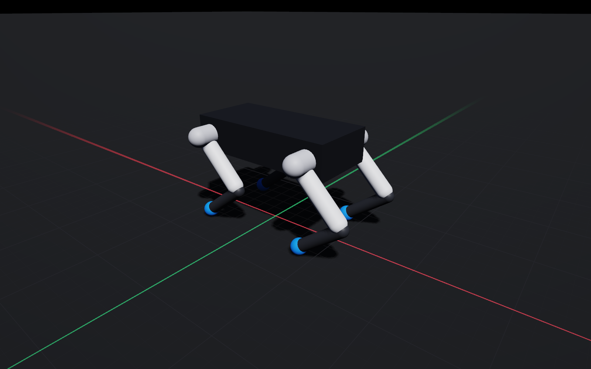
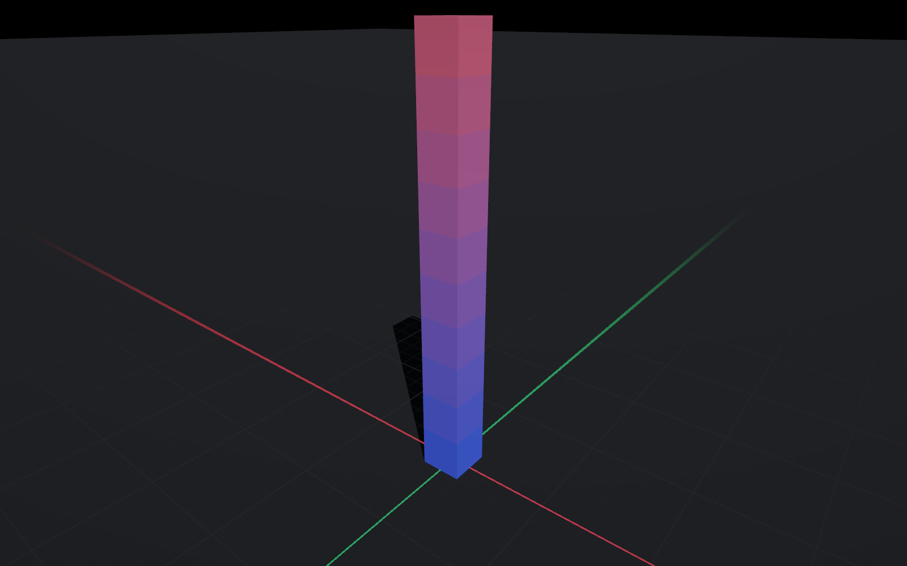
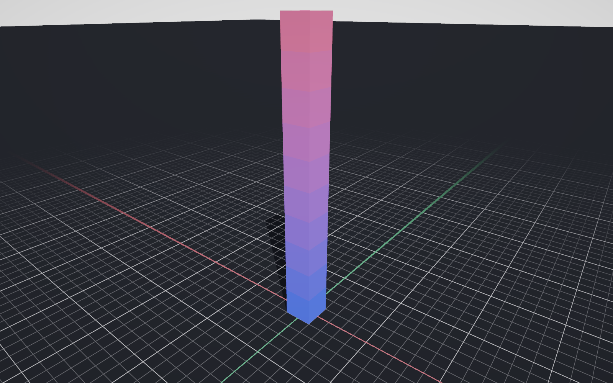
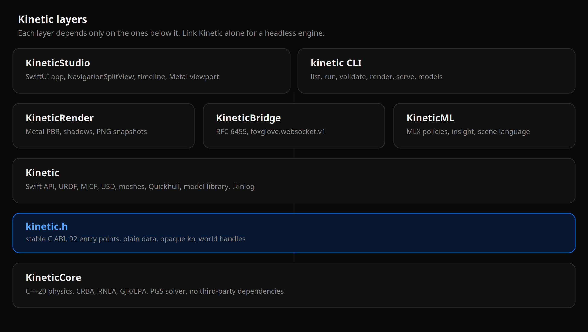

# Kinetic

<p class="kn-pitch">
  Native macOS robotics simulation.<br>
  C++20 physics. Metal renderer. Foxglove telemetry.<br>
  <span class="kn-no">No Python. No ROS. No container. No CUDA.</span>
</p>

<div class="kn-stats">
  <div class="kn-stat"><span class="value">142×</span><span class="label">quadruped realtime, M4</span></div>
  <div class="kn-stat"><span class="value">5.1×</span><span class="label">60 dominoes, 282 contacts</span></div>
  <div class="kn-stat"><span class="value">0.0 mm</span><span class="label">resting penetration</span></div>
  <div class="kn-stat"><span class="value">120 m/s</span><span class="label">stops at a 10 mm wall</span></div>
</div>

<p class="kn-caption">M4 numbers from <code>kinetic bench</code> on that machine. Resting contact and the
projectile are <code>kinetic validate</code>. Neither was re-measured in this Linux
checkout. Full table: <a href="reference/benchmarks.html">Benchmarks</a>.</p>

<div class="kn-hero">
  
  <p class="kn-caption">A twelve-actuator quadruped holding a crouch. Rendered headless with
  <code>kinetic render quadruped</code>. Same renderer the viewport uses.</p>
</div>

One repository: a C++20 rigid-body engine, a Metal renderer, Kinetic Studio,
a Foxglove WebSocket server, and on-device ML. `swift build` produces the
whole system in under a minute. The result is a Mach-O binary plus an app
bundle.

```bash
git clone https://github.com/shubhxho/kinetic
cd kinetic
swift build -c release
./.build/release/kinetic validate
```

## Where to go

<div class="kn-cards">
  <a class="kn-card" href="getting-started/install.html">
    <h3>Install and run</h3>
    <p>Build from source, verify the engine, bundle the app, put the CLI on your
    PATH. Configuration has no secrets file.</p>
  </a>
  <a class="kn-card" href="getting-started/first-simulation.html">
    <h3>Your first simulation</h3>
    <p>A ball, an arm, a real URDF — and how to read results back out.</p>
  </a>
  <a class="kn-card" href="physics/dynamics.html">
    <h3>How the physics works</h3>
    <p>The actual algorithms, with the equations they implement and why each
    choice was made.</p>
  </a>
  <a class="kn-card" href="cookbook.html">
    <h3>Cookbook</h3>
    <p>Control loops, teleoperation, parameter sweeps, CI regression images,
    resolved-rate control.</p>
  </a>
  <a class="kn-card" href="reference/benchmarks.html">
    <h3>Benchmarks</h3>
    <p>Measured numbers, the invariant suite, where the time goes, and what
    the last rewrite changed.</p>
  </a>
  <a class="kn-card" href="reference/comparison.html">
    <h3>How it compares</h3>
    <p>Against Isaac, MuJoCo, Bullet, Gazebo and Foxglove — including where each
    of them wins.</p>
  </a>
</div>

## What it is for

Kinetic is aimed at the loop you actually spend time in: change a model or a
controller, watch what happens, work out why it happened.

That means the parts most simulators treat as afterthoughts are first-class
here. Contact forces are drawn as arrows, not hidden in a log. The solver
publishes its own residual and iteration count as a plottable channel. The
timeline holds the last twenty seconds of full simulation state, so when
something goes wrong you drag backwards into it rather than restarting with more
print statements.

## What it is not

- **Not a GPU-parallel training farm.** Isaac Sim and Isaac Lab exist to run
  thousands of environments at once on NVIDIA hardware. Kinetic runs one world
  extremely well on the machine you are sitting at. If your bottleneck is
  reinforcement-learning throughput, this is the wrong tool.
- **Not a photorealistic renderer.** The viewport is a real PBR renderer with
  shadows and tone mapping, but it is built to make *physics* legible, not to
  produce marketing footage.
- **Not cross-platform.** The physics core is portable C++ with no dependencies,
  but the renderer is Metal and the app is AppKit and SwiftUI.

## A tour in one page

```swift
import Kinetic

let world = World()
world.addGround(friction: 1.0)

for i in 0..<10 {
    world.addRigidBody(
        name: "box\(i)",
        shape: .box(halfExtents: Vec3(0.1, 0.1, 0.1)),
        density: 500,
        pose: Pose(position: Vec3(0, 0, 0.1 + 0.2005 * Double(i))))
}
world.compile()

world.step(3000)                     // six seconds at the default 500 Hz
print(world.contacts().count)        // 40 contact points holding the tower up
print(world.centerOfMass)            // SIMD3<Double>(0.0, 0.0, 1.0)
```

<div class="kn-compare">
  <div class="kn-figure">
    
    <p class="kn-caption">Dark theme. Forty contact points, max height drift 7 mm.</p>
  </div>
  <div class="kn-figure">
    
    <p class="kn-caption"><code>kinetic render stack --light</code>. Same Metal renderer.</p>
  </div>
</div>

The same model can be loaded from URDF or MJCF, streamed to Foxglove, recorded
to a seekable `.kinlog`, rendered headless to a PNG, or opened in Studio. USD
is a Swift API, not a CLI input.

## The system, in one diagram

<div class="kn-figure">
  
  <p class="kn-caption">Each layer depends only on the ones below it, and each can
  be used without the ones above. Linking <code>Kinetic</code> alone gives a headless
  engine with no GUI dependency. SVG source: <code>images/architecture.svg</code>.</p>
</div>

## How the book is organised

| Part | What it covers |
| --- | --- |
| [Getting started](./getting-started/install.md) | Building, first simulation, Studio, CLI, configuration |
| [Concepts](./concepts/architecture.md) | How the pieces fit, and the conventions everything obeys |
| [Physics](./physics/dynamics.md) | The actual algorithms, with the equations they implement |
| [Cookbook](./cookbook.md) | Complete, runnable recipes for common tasks |
| [Formats](./formats/urdf.md) | What Kinetic reads and writes, and where the edges are |
| [Telemetry](./telemetry/foxglove.md) | Streaming a live simulation to external tools |
| [API reference](./api/swift.md) | The Swift and C surfaces |
| [Reference](./reference/benchmarks.md) | Measured numbers, comparisons, shortcuts, glossary |

If you want to understand the engine rather than use it, start at
[Rigid-body dynamics](./physics/dynamics.md) — it explains the coordinate
choice that everything else follows from.

## Status

The C ABI reports `1.0.0` (`KN_VERSION_*` in `kinetic.h`). Git tags include
`v1.0.0` and `v1.1.0`; this tree is `main` ahead of those tags. The physics
core is validated against closed-form solutions and conservation laws on every
CI run of `kinetic validate`; see
[Accuracy and validation](./physics/accuracy.md) for the current numbers and
exactly what each check proves.

The layer and data-flow drawings used in the README and this book are committed
as `docs/src/images/architecture.svg` / `.png` and
`docs/src/images/data-flow.svg` / `.png`. Scene figures such as
`images/quadruped.png` are headless `kinetic render` captures from macOS, not
screenshots of a live Studio window.
